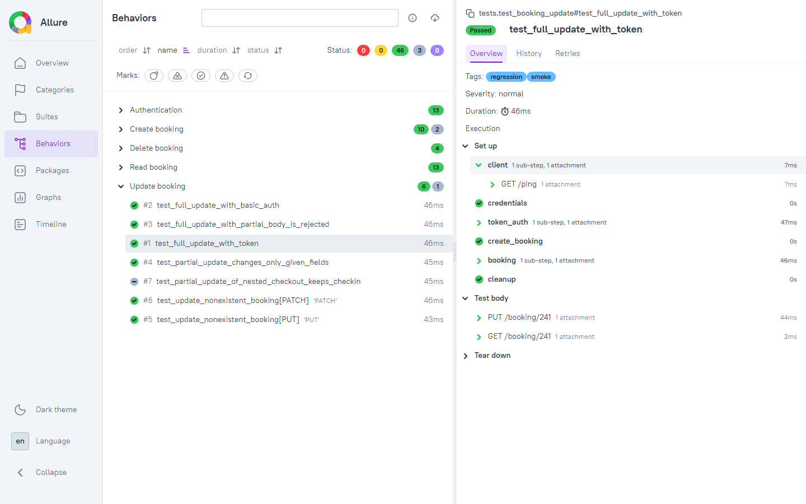

# API Testing with Pytest

[](https://github.com/FrancoDuperre/api-testing-pytest/actions/workflows/api-tests.yml)

A Python + Pytest regression suite for the [Restful-Booker](https://restful-booker.herokuapp.com/apidoc/index.html) practice API, covering every endpoint with positive and negative cases, response schema validation and self-cleaning test data.

## What's inside

- **49 tests** across auth and booking create / read / update / delete: 46 passing plus 3 `xfail` that document real API bugs
- **A small API client** (`BookingClient`) on top of `requests`, so tests read as intent instead of raw HTTP calls
- **Strict response schemas** with Pydantic: wrong types or unexpected fields fail the test
- **Self-cleaning fixtures**: every test creates its own booking and deletes it afterwards
- **Runs against a local Docker instance** in CI, so results do not depend on the shared public API
- **Allure report** with every request and response attached, published as a CI artifact

## Quick start

Requires Python 3.12 and, for the local API, Docker.

```bash
git clone https://github.com/FrancoDuperre/api-testing-pytest.git
cd api-testing-pytest
python -m venv .venv
source .venv/bin/activate          # Windows: .venv\Scripts\activate
pip install -r requirements.txt
cp .env.example .env               # then fill in the admin credentials from the API docs
```

**With Docker (recommended):** stable, isolated data.

```bash
docker compose up -d --wait        # the first run builds the API image
pytest                             # full suite
pytest -m smoke                    # one happy path per endpoint
```

**Without Docker:** point `BASE_URL` in `.env` at the public instance (`https://restful-booker.herokuapp.com`) and run `pytest`. It is shared and resets itself every 10 minutes, so it is slower and less predictable.

**Allure report** (needs the [Allure CLI](https://allurereport.org/docs/install/)):

```bash
pytest --alluredir=allure-results
allure serve allure-results
```

## Endpoints covered

| Endpoint | Scenarios |
| --- | --- |
| `POST /auth` | valid credentials, wrong password, unknown user, empty credentials |
| `POST /booking` | valid payload, optional field omitted, each required field missing, wrong types, schema validation, read-back |
| `GET /booking` | list contains new booking, filter by name, case sensitivity, no match, `checkin` / `checkout` date filters |
| `GET /booking/{id}` | JSON and XML responses, non-existent and non-numeric ids |
| `PUT /booking/{id}` | full update with token cookie and with Basic auth, incomplete body, non-existent id |
| `PATCH /booking/{id}` | partial update keeps other fields, non-existent id, nested date update |
| `DELETE /booking/{id}` | delete with token and Basic auth, booking is gone afterwards, double delete, non-existent id |
| `PUT` / `PATCH` / `DELETE` | without auth, with an invalid token, with wrong Basic auth: all rejected and the booking is unchanged |

## Unusual API behavior found

Restful-Booker is a practice API that its author ships ["loaded with a bunch of bugs for you to explore"](https://restful-booker.herokuapp.com/), so finding them is part of the exercise. Each item below was confirmed by calling the API (the public instance and the Docker build give the same results). Tests assert the real behavior, with a comment pointing here, so the suite catches any change.

| Behavior | Expected | Actual |
| --- | --- | --- |
| Failed login | `401` | `200` with `{"reason": "Bad credentials"}` |
| Missing required field or wrong type on create | `400` | `500 Internal Server Error` |
| Update or delete a non-existent booking | `404` | `405 Method Not Allowed` |
| Successful delete | `200` / `204` | `201 Created` (documented, but unusual) |
| `GET /booking/{id}` with `Accept: application/xml` | `Content-Type: application/xml` | XML body served as `text/html` |
| `checkin` filter | docs: on or after the date | strictly **after** the date |
| `checkout` filter | docs: on or after the date | on or **before** the date |
| Name filters | not specified | case-sensitive |

These are bugs rather than quirks, so they are marked `xfail` (strict: if the API gets fixed, the test fails and asks to be updated):

- A non-numeric `totalprice` is accepted and stored as `null`.
- An invalid date is accepted and stored as `"0NaN-aN-aN"`.
- `PATCH` with only `bookingdates.checkout` wipes the check-in date to `"0NaN-aN-aN"`.

The upstream README still mentions MongoDB, but the current code uses an in-memory database (LokiJS), so the Docker setup needs no database container.

## Project structure

```
src/
  client.py       BookingClient (one method per endpoint) and TokenAuth (token cookie)
  schemas.py      Pydantic models for every response body
  builders.py     Payload builders with unique guest names
tests/
  conftest.py     Fixtures: client, credentials, token and Basic auth, bookings with cleanup
  test_auth.py
  test_booking_create.py
  test_booking_read.py
  test_booking_update.py
  test_booking_delete.py
docker-compose.yml  Builds Restful-Booker from upstream source, pinned to a commit
pytest.ini          Markers (smoke, regression), strict xfail
```

## Design decisions

- **Client returns raw responses.** Hiding status codes inside the client would make the negative tests impossible to write. The client only removes boilerplate (base URL, headers, auth) and logs each call as an Allure step.
- **Auth as `requests` auth objects.** The API accepts a token cookie or Basic auth; both are plain `AuthBase` objects passed per call, so "no auth", "bad token" and "valid token" are just different arguments.
- **Unique data per test.** Builders give every booking a random first name, which makes name filters return exactly one result even on the shared public instance, and lets tests run in any order.
- **Cleanup through a fixture.** Created ids are registered and deleted on teardown, even when the test fails. Running the suite three times in a row leaves the local booking count unchanged.
- **Docker image built from source.** Restful-Booker has no published image, so `docker-compose.yml` builds it from the upstream repo pinned to a commit. That keeps CI reproducible if upstream changes.
- **No credentials in the repo.** Admin credentials come from a gitignored `.env` locally and from GitHub Actions secrets in CI.

## Reports

Every CI run uploads the Allure report as a build artifact (a single HTML file you can open directly). Each test shows its setup, the HTTP calls it made and the response bodies.



## About

Franco Duperre, QA Automation Engineer. Open to freelance work: <Upwork profile link>
